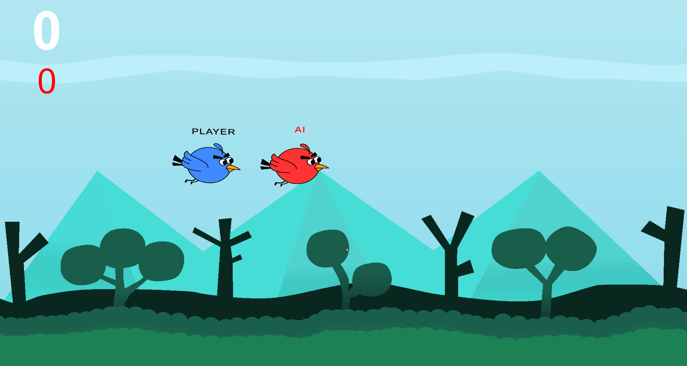
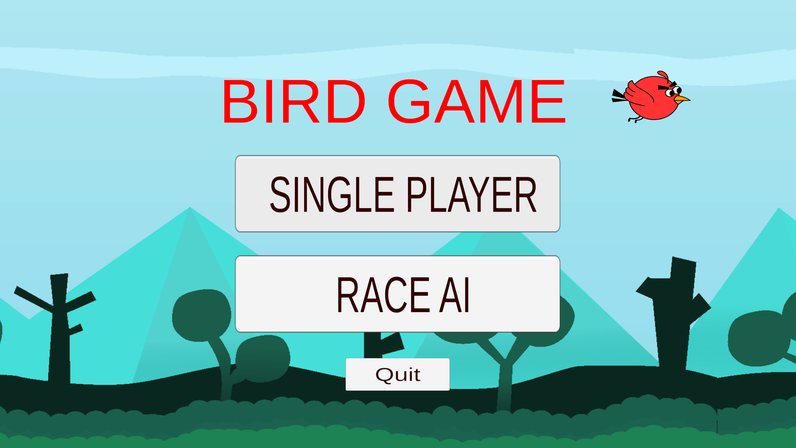
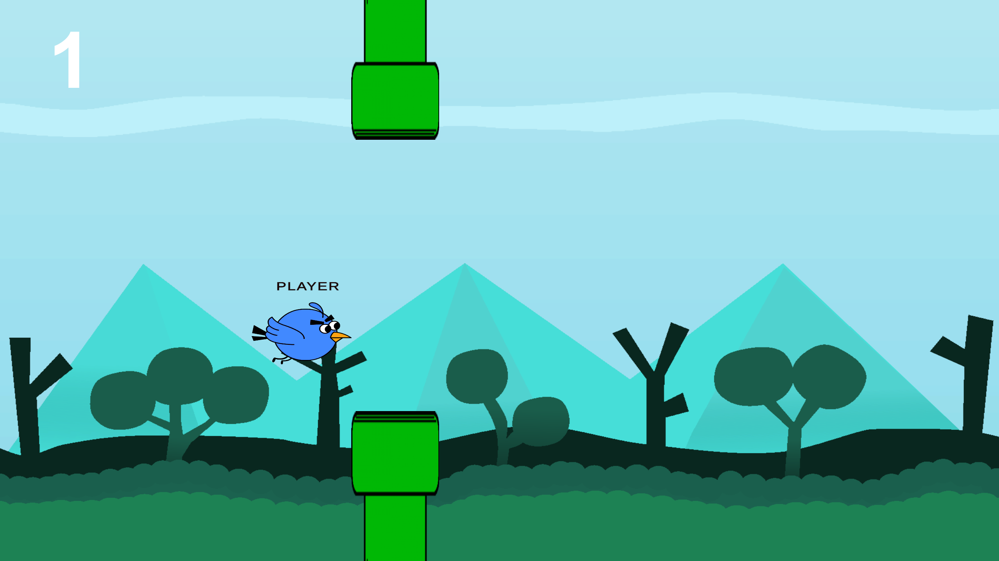
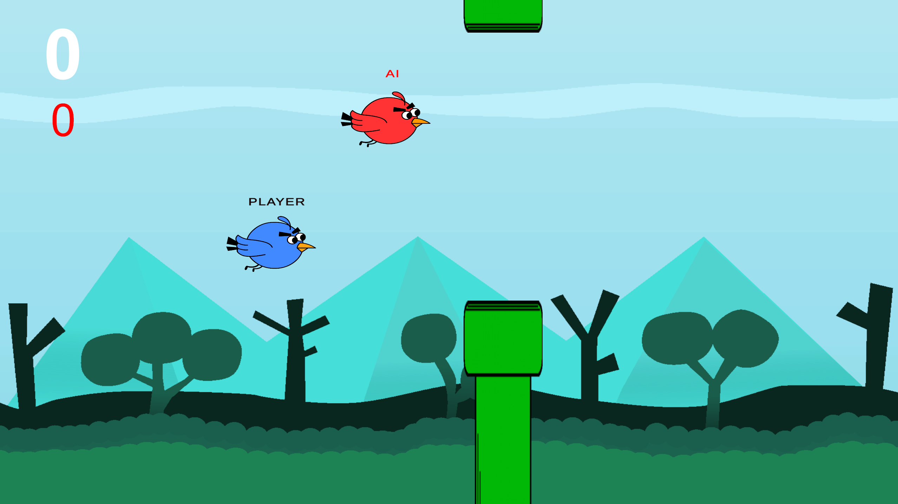
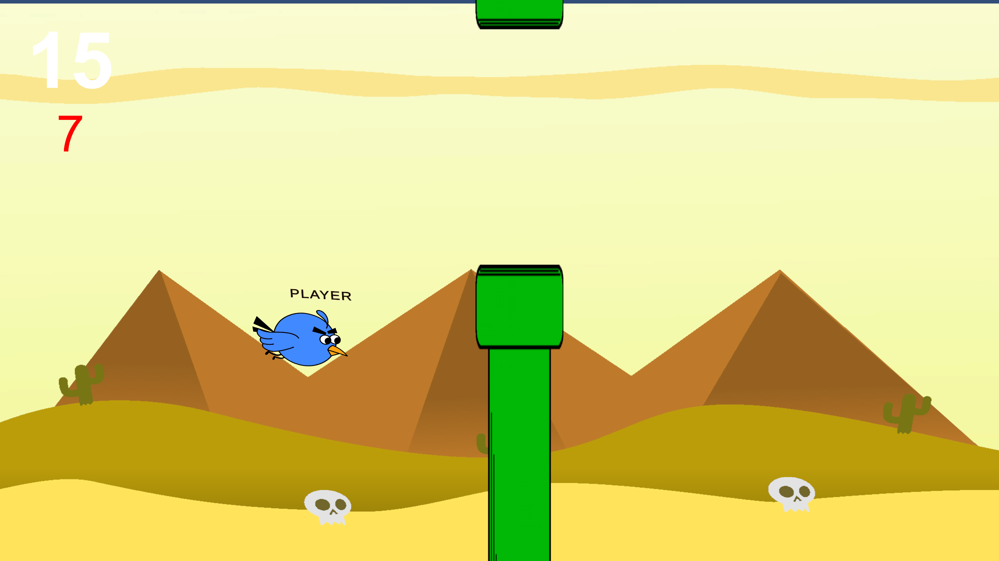
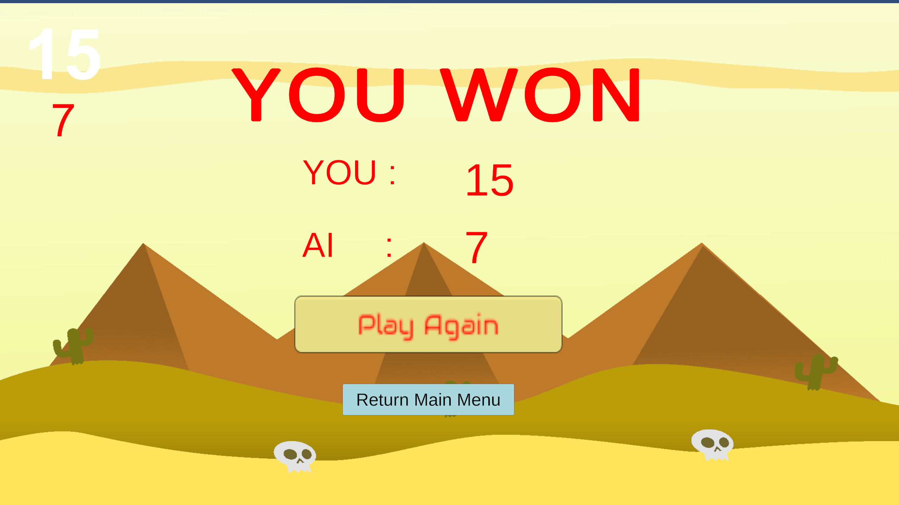
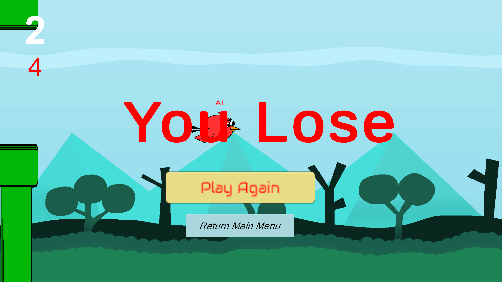

# Bird Game: Flappy Bird vs. AI

A Flappy Bird-style game built in **Unity 6** where you can play solo or **race against a bird controlled by a neural network** that I trained with reinforcement learning (Unity ML-Agents).

## Features

- **Two game modes:** Single Player, or Race vs. AI, where you and the AI bird fly through the same pipes and the higher score wins.
- **Trained AI opponent:** a neural network trained for about 500k steps with Unity ML-Agents, running in-game through an ONNX model.
- **Difficulty that ramps up:** pipe speed and spawn rate increase with score, and pipe gap sizes are random.
- **Bonus fruit:** fruit appears at random and is worth +5 points.
- **Changing scenery:** the background switches at score milestones (10 and 20).
- **Polish:** main menu, win and game-over screens, sound effects, and the bird tilts as it climbs and falls.

## Screenshots

| Main Menu | Single Player | Race vs. AI |
|:---:|:---:|:---:|
|  |  |  |

| Desert Stage (score 10+) | You Won | You Lose |
|:---:|:---:|:---:|
|  |  |  |

## How the AI Works

I built the AI in two stages:

1. **Q-Learning prototype** ([QBrain.cs](Assets/QBrain.cs)): I wrote tabular Q-learning from scratch. The distance to the next pipe is grouped into a 10×10 grid, the bird explores with an epsilon-greedy policy, and the Q-table is saved to disk between sessions.
2. **Deep RL with ML-Agents** ([BirdAgent.cs](Assets/BirdAgent.cs)): I replaced the grid with continuous inputs so the agent could learn finer control.
   - **Observations:** the bird's height, its vertical speed, and the X and Y distance to the next pipe gap
   - **Actions:** flap or do nothing
   - **Rewards:** +0.01 for each step it stays alive, −1.0 when it crashes

## Tech Stack

Unity 6 (6000.4) · C# · Unity ML-Agents 4.0 · PyTorch (training) · ONNX (inference) · Universal Render Pipeline 2D

## Controls

| Action | Input |
|---|---|
| Flap | `Space` or left mouse click |

## Run Locally

1. Clone the repo and open it in **Unity 6000.4.1f1** or later.
2. Open `Assets/Scenes/MainMenu.unity` and press **Play**.
